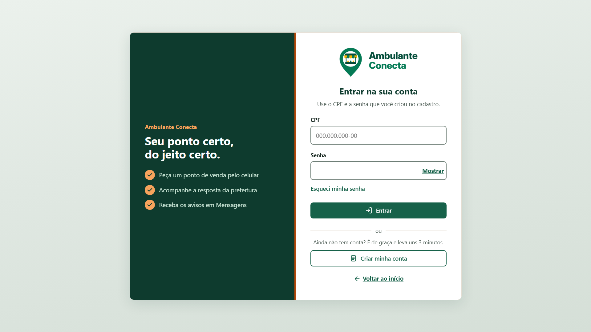
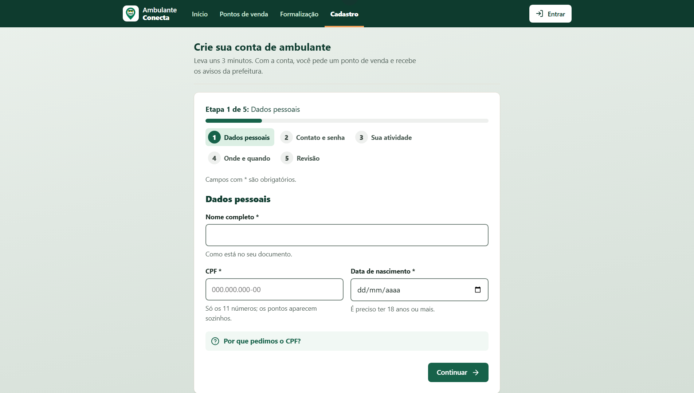
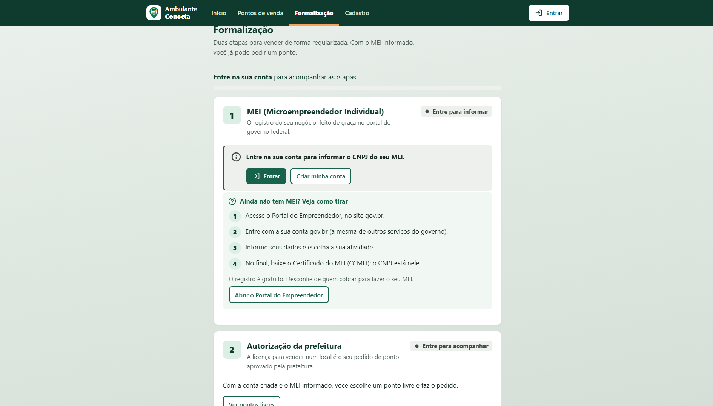
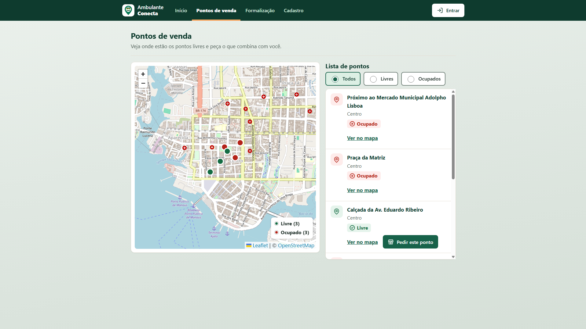
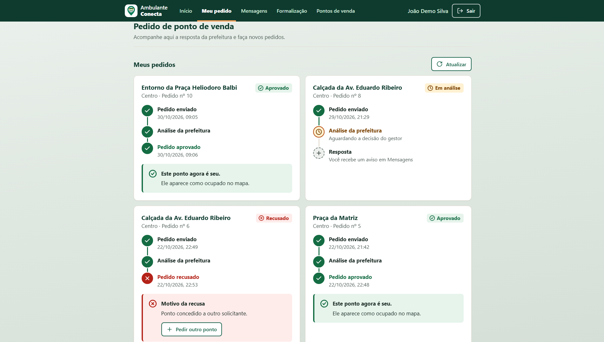
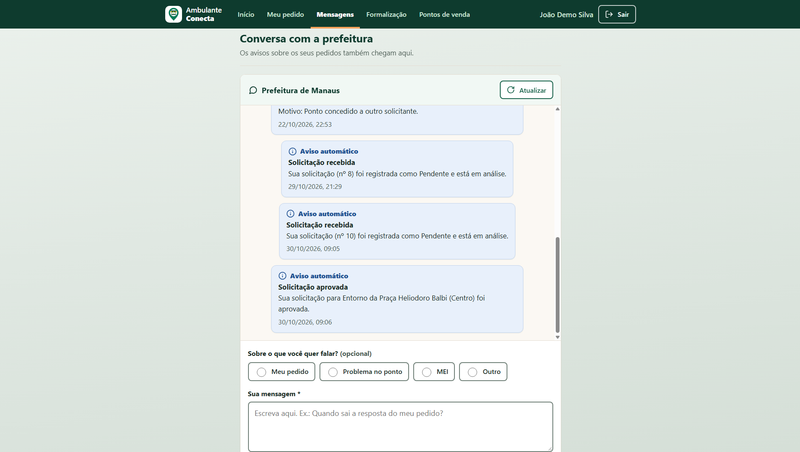
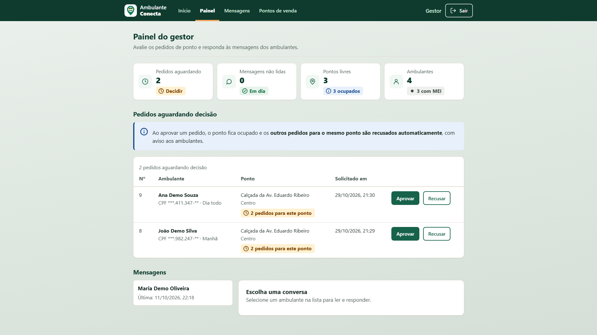
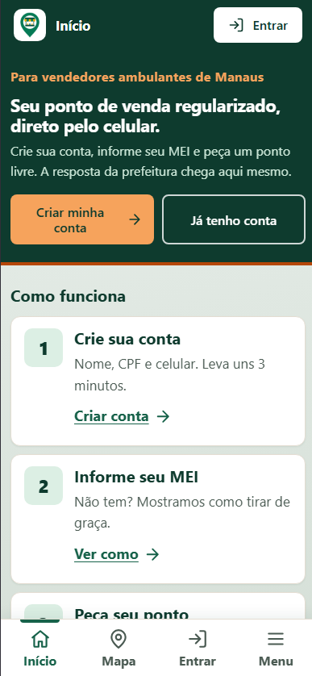

# 🛒 Ambulante Conecta

<div align="center">


**Sistema web para apoiar a formalização, a organização e a comunicação de trabalhadores ambulantes em Manaus/AM.**

*Seu ponto certo, do jeito certo.*

[](LICENSE)
[](https://github.com/Ambulante-Conecta/ambulante-conecta/actions/workflows/deploy.yml)
[](#-testes)
[](https://github.com/Ambulante-Conecta/ambulante-conecta/stargazers)
[](https://github.com/Ambulante-Conecta/ambulante-conecta/network/members)
[](CONTRIBUTING.md)

[Site ao vivo](https://ambulante-conecta.github.io/ambulante-conecta/) · [API](https://ambulante-conecta.onrender.com/api/pontos) · [Reportar bug](https://github.com/Ambulante-Conecta/ambulante-conecta/issues/new?labels=bug) · [Sugerir melhoria](https://github.com/Ambulante-Conecta/ambulante-conecta/issues/new?labels=melhoria)

<sub>A API usa o plano gratuito do Render: depois de 15 minutos sem uso, a primeira chamada pode levar cerca de 1 minuto. O site avisa "o servidor está acordando" enquanto isso.</sub>

</div>

---

## 📋 Sobre o Projeto

Cerca de 90% dos vendedores ambulantes de Manaus permanecem na informalidade (Bezerra; Silva, 2021). As informações sobre o registro como Microempreendedor Individual (MEI), a licença municipal e os locais autorizados para vender estão espalhadas em canais diferentes, e não há um canal direto de conversa com a prefeitura.

O **Ambulante Conecta** reúne num só lugar o cadastro do ambulante, a orientação sobre formalização, o mapa e o pedido de pontos de venda, a conversa com a prefeitura e um painel para o gestor público. O objetivo é apoiar a formalização e a organização dos trabalhadores ambulantes, alinhado ao **ODS 8 (Meta 8.3)** da Agenda 2030.

É o Trabalho de Conclusão de Curso (TCC) de **Análise e Desenvolvimento de Sistemas** do **Centro Universitário CEUNI FAMETRO**.

### ✨ Principais Funcionalidades

- 👤 **Cadastro em 5 etapas (RF01)** - CPF e CNPJ validados pelo módulo 11, regras da senha mostradas ao vivo, turno de trabalho e consentimento LGPD registrado
- 🔐 **Login e recuperação de senha** - perfis ambulante e gestor com JWT; a troca de senha encerra as sessões abertas em outros aparelhos
- 📋 **Formalização (RF02)** - passo a passo do MEI e campo para informar o CNPJ, que libera o pedido de ponto
- 🗺️ **Mapa de pontos de venda (RF03)** - Leaflet + OpenStreetMap, com cor, ícone e texto por situação e lista acessível ao lado
- 📝 **Meu pedido (RF04)** - pedido de ponto livre e andamento em linha do tempo (Enviado → Análise → Aprovado ou Recusado, com o motivo)
- 💬 **Mensagens (RF05)** - conversa com a prefeitura e avisos automáticos (pedido recebido, aprovado, recusado, senha alterada)
- ⚖️ **Avaliação pelo gestor (RF06)** - aprovar com confirmação ou recusar com justificativa obrigatória; CPF mascarado
- 📊 **Painel do gestor (RF07)** - pedidos aguardando, mensagens não lidas, pontos livres e ambulantes com MEI
- 📶 **Feito para rede móvel instável** - tempo limite, nova tentativa automática e avisos de "sem internet" e "servidor acordando"

### 📐 Requisitos e regras de negócio

| Requisito | Onde está |
|---|---|
| **RF01** Cadastro e diagnóstico do trabalhador | `cadastro.html`, `POST /api/ambulantes` |
| **RF02** Orientação sobre formalização (MEI e licença municipal) | `formalizacao.html`, `GET`/`PATCH /api/ambulantes/me` |
| **RF03** Consulta de pontos no mapa | `mapa.html`, `index.html`, `GET /api/pontos` |
| **RF04** Solicitação de ponto disponível | `situacao.html` (Meu pedido), `POST /api/solicitacoes` |
| **RF05** Comunicação com a prefeitura | `comunicacao.html`, painel do gestor, rotas `/api/mensagens` |
| **RF06** Avaliação das solicitações pelo gestor | `painel.html`, `PATCH /api/solicitacoes/:id` |
| **RF07** Painel de gestão | `painel.html`, `GET /api/painel` |

Regras de negócio (numeração igual à Tabela 4 do artigo):

- **RN01 – Autenticação obrigatória:** a solicitação de pontos exige ambulante cadastrado e com sessão iniciada.
- **RN02 – MEI ativo:** o sistema só registra a solicitação se o ambulante tiver MEI/CNPJ ativo; caso contrário, o pedido é rejeitado (HTTP 422).
- **RN03 – Estado inicial e aviso:** toda solicitação nasce como **Pendente** e gera um aviso automático informando que o pedido está em análise.
- **RN04 – Avaliação exclusiva do gestor:** apenas o gestor aprova ou recusa solicitações; a recusa exige justificativa (5 a 500 caracteres).
- **RN05 – Concorrência de pontos:** quando o gestor aprova um pedido, o ponto passa a ocupado e os outros pedidos pendentes para o mesmo ponto são recusados automaticamente, com a justificativa "Ponto concedido a outro solicitante." e aviso aos ambulantes. Tudo acontece numa transação com bloqueio das linhas (`FOR UPDATE`), para que duas avaliações ao mesmo tempo não concedam o mesmo ponto.
- **RN06 – Acesso ao painel:** o painel de gestão é exclusivo do perfil gestor.

| RNF | Como foi atendido |
|---|---|
| **RNF01** Interface simples e acessível | Heurísticas de Nielsen, WCAG 2.1 AA e e-MAG |
| **RNF02** Autenticação e proteção | JWT, perfis, senha com hash, limite de tentativas, recuperação de senha que encerra sessões antigas |
| **RNF03** Funcionamento em celulares | Telas pensadas primeiro para o celular; testadas em 360, 390, 768 e 1024 px |
| **RNF04** Navegadores atuais, sem instalação | Site web em HTML, CSS e JavaScript puros |
| **RNF05** LGPD | Ver [Segurança e LGPD](#-segurança-e-lgpd) |
| **RNF06** Conectividade limitada | Sem frameworks nem fontes externas; tempo limite e nova tentativa automática; a tela se atualiza sozinha quando a conexão volta |

### 🔒 Segurança e LGPD

- Senhas guardadas com hash **bcrypt** (biblioteca `bcryptjs`) e nunca devolvidas pela API.
- Token **JWT** com validade de 8 horas; sessões antigas deixam de valer quando a senha é trocada.
- Controle de acesso por perfil em cada rota (`403` para quem não tem permissão).
- **CPF mascarado** para o gestor (ex.: `***.444.777-**`); o painel mostra só números agregados.
- **Consentimento** do ambulante registrado com a data no cadastro.
- Consultas SQL parametrizadas; CORS restrito ao endereço do site; limite de tentativas no login (20 a cada 15 min) e na recuperação de senha (5 a cada 15 min).
- Login e recuperação com mensagem de erro única, que não revela se um CPF tem conta.
- Segredos só em variáveis de ambiente: o `.env` nunca vai para o Git.

O tratamento de dados segue a **Lei nº 13.709/2018 (LGPD)**.

### ♿ Acessibilidade e usabilidade

Identidade visual **"Amazônico acolhedor"**: verde-floresta, laranja tucumã e fundo em verde opaco, com o logo do alfinete com a barraca.

- Contraste conferido em todas as combinações: texto com pelo menos 4,5:1; bordas de campo e contorno de foco com pelo menos 3:1.
- Nenhum texto abaixo de 16 px; botões com 48 px de altura e áreas de toque de pelo menos 44 px.
- **Cor nunca sozinha:** todo status tem ícone e texto (✓ aprovado, relógio em análise, ✕ recusado).
- HTML semântico, navegação completa por teclado, contorno de foco visível, link "Ir para o conteúdo" e textos para leitor de tela.

| Heurística de Nielsen | Exemplos no sistema |
|---|---|
| 1. Visibilidade do status | Etapas com barra de progresso, linha do tempo do pedido, avisos de conexão |
| 2. Linguagem do usuário | "Em análise", "Livre", "Meu pedido" |
| 3. Controle e liberdade | Voltar, "Corrigir" na revisão, cancelar, mostrar senha |
| 4. Consistência | Os mesmos botões, cartões e selos em todas as telas |
| 5. Prevenção de erros | Regras da senha ao vivo, pontos já pedidos bloqueados, confirmação antes de aprovar |
| 6. Reconhecimento | Opções em botões, "Seu próximo passo" na página inicial |
| 7. Flexibilidade | Menu no topo (computador) e menu inferior com gaveta (celular), atalhos para o ponto no mapa |
| 8. Design minimalista | Uma ação principal por tela, listas compactas |
| 9. Mensagens de erro | Erro embaixo do campo certo, dizendo o que fazer |
| 10. Ajuda | "O que é MEI?", "Veja como tirar", "Não lembro desses dados" |

### ⚠️ Limitações conhecidas

- Sem integração com os sistemas oficiais (Portal do Empreendedor e Semef Atende); o sistema orienta e leva até eles.
- A recuperação de senha confere os dados do cadastro, mas **não envia código** por SMS ou e-mail.
- A autorização da prefeitura é representada pelo pedido de ponto aprovado no próprio sistema.
- No plano gratuito do Render, a API "dorme" após 15 minutos sem uso.
- Protótipo acadêmico, ainda não implantado pela Prefeitura de Manaus.

---

## 🎬 Demonstração

### Screenshots

**[Tela Inicial]**


**[Login]**


**[Cadastro]**


**[Formalização]**


**[Mapa de pontos de venda]**


**[Meu pedido]**


**[Mensagens]**


**[Painel do gestor]**


**[Versão para celular]**
<div align="center">
   
</div>
### Vídeo de demostração

**[Fluxo principal]**

---

## 🛠️ Tecnologias Utilizadas

### Frontend
- 
- 
-  (ES6+, Fetch API, sem frameworks)
- 
- 

### Backend
- 
- 
- 
-  (com `bcryptjs`, `express-rate-limit` e `cors`)

### Ferramentas
- 
- 
- 
- 
- 
-  (com Live Server)
- 

### Arquitetura

```text
Navegador (celular ou computador)
   │  HTML, CSS e JavaScript — GitHub Pages
   │  Fetch API + token JWT
   ▼
API REST — Node.js + Express — Render
   ├── Rotas (/api/...)
   ├── Middlewares: autenticação (JWT) e perfil (ambulante / gestor)
   ├── Regras de negócio e validações (CPF, CNPJ, senha)
   ▼
PostgreSQL + PostGIS — Neon
```

---

## 🚀 Começando

### 📦 Pré-requisitos

Antes de começar, certifique-se de ter instalado:

- [Node.js](https://nodejs.org/) (versão 20 ou superior) e npm
- [PostgreSQL](https://www.postgresql.org/) com a extensão [PostGIS](https://postgis.net/)
- [Git](https://git-scm.com/)
- [VS Code](https://code.visualstudio.com/) com a extensão **Live Server**

### 💻 Instalação

1. **Clone o repositório**
   ```bash
   git clone https://github.com/Ambulante-Conecta/ambulante-conecta.git
   ```

2. **Acesse a pasta do back-end**
   ```bash
   cd ambulante-conecta/backend-ambulante
   ```

3. **Instale as dependências**
   ```bash
   npm install
   ```
   > Rode `npm install` **somente** dentro de `backend-ambulante` (é a única pasta com `package.json`).

4. **Configure as variáveis de ambiente**
   ```bash
   cp .env.example .env
   ```

   Edite o arquivo `.env` com suas configurações:
   ```env
   DB_HOST=localhost
   DB_USER=seu_usuario
   DB_PASSWORD=sua_senha
   DB_NAME=seu_banco
   PORT=3000
   LOGIN_LIMITE=200
   JWT_SECRET=gere_com_o_comando_abaixo
   ```
   Para gerar o `JWT_SECRET` (mínimo de 32 caracteres):
   ```bash
   node -e "console.log(require('crypto').randomBytes(48).toString('hex'))"
   ```

5. **Prepare o banco de dados**

   Crie o banco e rode `database/schema.sql` e depois `database/seed.sql`. Num banco que já existia, aplique só as migrações que faltam em `database/migracoes/` (todas podem rodar mais de uma vez).
   ```bash
   psql -U seu_usuario -d seu_banco -f ../database/schema.sql
   psql -U seu_usuario -d seu_banco -f ../database/seed.sql
   ```

6. **Crie o gestor e as contas de demonstração**
   ```bash
   node scripts/criar-gestor.js <CPF válido>
   npm run demo
   ```
   As senhas aparecem uma única vez no terminal. **Atenção:** `npm run demo` apaga cadastros, pedidos e mensagens do banco local.

7. **Execute a API**
   ```bash
   npm start
   ```

8. **Abra o front-end no navegador**

   Abra `frontend/index.html` com o **Live Server** do VS Code:
   ```
   http://127.0.0.1:5500/frontend/index.html
   ```
   A API roda em `http://localhost:3000/api` e só aceita o front na porta 5500 (`localhost` ou `127.0.0.1`).

### ☁️ Publicação (deploy)

| Parte | Serviço | Como atualiza |
|---|---|---|
| Front-end | GitHub Pages | Sozinho, a cada push na `main` (GitHub Actions) |
| API | Render (plano gratuito) | Sozinho, a cada push na `main` |
| Banco | Neon (PostgreSQL + PostGIS) | Migrações novas com `scripts/preparar-banco-publicado.js` **antes** do push |

Variáveis no Render: `DATABASE_URL`, `JWT_SECRET`, `NODE_ENV=production` e `CORS_ORIGINS=https://ambulante-conecta.github.io`.

---

## 📖 Como Usar

### Exemplo Básico

O caminho do ambulante no site:

```text
Cadastro ─► Login ─► Formalização (CNPJ do MEI) ─► Mapa / Meu pedido ─► Pedido "Pendente" + aviso (RN03)
                                                                              │
                                                     Gestor avalia (RN04) ◄───┘
                                                       ├── Aprova ─► ponto ocupado; concorrentes recusados (RN05)
                                                       └── Recusa ─► justificativa obrigatória
                                                                              │
                                                     Resultado em Mensagens ◄─┘
```

Para testar sem cadastrar ninguém, use as contas criadas por `npm run demo`:

| Conta | CPF | MEI |
|---|---|---|
| João Demo Silva | 52998224725 | sim (ocupa o 1º ponto) |
| Maria Demo Oliveira | 11144477735 | **não** (mostra o bloqueio da RN02) |
| Ana Demo Souza | 93541134780 | sim (tem 1 pedido pendente no 2º ponto) |

### Exemplo Avançado

Usando a API direto com `fetch`: login do ambulante, pontos livres e pedido de ponto.

```javascript
const API = "http://localhost:3000/api";

// 1. Login com CPF e senha: devolve o token JWT e os dados do usuário
const login = await fetch(`${API}/auth/login`, {
  method: "POST",
  headers: { "Content-Type": "application/json" },
  body: JSON.stringify({ cpf: "93541134780", senha: "senha-da-demo" })
}).then((r) => r.json());

const cabecalhos = {
  "Content-Type": "application/json",
  Authorization: `Bearer ${login.token}`
};

// 2. Pontos livres (GeoJSON): os dados ficam em features[].properties
const geo = await fetch(`${API}/pontos?status=disponivel`).then((r) => r.json());
const ponto = geo.features[0].properties; // { id, descricao_local, bairro, status }

// 3. Pedido do ponto: nasce "Pendente" e gera um aviso em Mensagens (RN03)
const resposta = await fetch(`${API}/solicitacoes`, {
  method: "POST",
  headers: cabecalhos,
  body: JSON.stringify({ ponto_id: ponto.id })
});

if (resposta.status === 422) console.log("Sem MEI: informe o CNPJ na Formalização (RN02).");
if (resposta.status === 409) console.log("Ponto ocupado ou pedido repetido.");
if (resposta.status === 201) console.log("Pedido enviado:", await resposta.json());
```

Todas as rotas ficam em `/api`. As protegidas exigem `Authorization: Bearer <token>`.

| Método | Rota | Quem |
|---|---|---|
| `POST` | `/api/ambulantes` | pública (cadastro) |
| `POST` | `/api/auth/login` | pública |
| `GET` | `/api/auth/me` | logado |
| `POST` | `/api/auth/recuperar-senha/verificar` · `/api/auth/recuperar-senha/nova` | pública |
| `GET` · `PATCH` | `/api/ambulantes/me` | ambulante (situação e CNPJ do MEI) |
| `GET` | `/api/pontos` | pública (GeoJSON) |
| `POST` | `/api/solicitacoes` | ambulante |
| `GET` | `/api/solicitacoes/minhas` | ambulante |
| `GET` | `/api/solicitacoes` | gestor |
| `PATCH` | `/api/solicitacoes/:id` | gestor (aprovar ou recusar) |
| `GET` · `POST` | `/api/mensagens` | logado |
| `GET` | `/api/mensagens/conversas` · `/api/mensagens/nao-lidas` | gestor · logado |
| `PATCH` | `/api/mensagens/:id/lida` · `/api/mensagens/lidas` | logado |
| `GET` | `/api/painel` | gestor |

Parâmetros, corpos e códigos de resposta de cada rota: [`backend-ambulante/api.md`](backend-ambulante/api.md).

---

## 🗂️ Estrutura de Pastas

```
📦 ambulante-conecta
├── 📁 .github/workflows/
│   └── 📄 deploy.yml                    # Publica a pasta frontend no GitHub Pages
├── 📁 backend-ambulante/                # API REST (Node.js + Express)
│   ├── 📁 postman/                      # Coleção, ambiente e roteiro de testes manuais
│   ├── 📁 resultados-testes/            # Relatórios do npm test (evidências)
│   ├── 📁 scripts/
│   │   ├── 📄 criar-gestor.js           # Cria o gestor ou redefine a senha dele
│   │   ├── 📄 preparar-demo.js          # Contas de demonstração (npm run demo)
│   │   └── 📄 preparar-banco-publicado.js  # Monta o banco do Neon
│   ├── 📁 src/
│   │   ├── 📁 config/                   # Conexão com o banco (local ou DATABASE_URL)
│   │   ├── 📁 controllers/              # Listagem de solicitações do gestor
│   │   ├── 📁 middlewares/              # JWT, perfis e sessões
│   │   ├── 📁 routes/                   # ambulantes, auth, pontos, solicitacoes, avaliacoes, mensagens, painel
│   │   ├── 📁 utils/                    # Validação de CPF, CNPJ, data e senha
│   │   └── 📄 testar-*.js               # Roteiros de teste (testar-tudo.js roda todos)
│   ├── 📄 api.md                        # Documentação de todas as rotas
│   ├── 📄 server.js                     # Ponto de entrada da API
│   ├── 📄 package.json
│   └── 📄 .env.example
├── 📁 database/
│   ├── 📁 migracoes/                    # 001 a 006 (005 = recuperação de senha; 006 = pedidos ligados ao ambulante e ao ponto)
│   ├── 📄 schema.sql                    # Estrutura completa do banco
│   ├── 📄 seed.sql                      # Pontos de venda e dados de exemplo
│   └── 📄 resetar_pontos.sql
├── 📁 frontend/                         # Site publicado no GitHub Pages
│   ├── 📁 css/                          # style.css: todo o visual
│   ├── 📁 img/                          # Logo e ícones
│   ├── 📁 js/                           # api.js (rede), app.js (menus e estados), icones.js e um script por página
│   ├── 📄 index.html                    # Início (próximo passo e mapa)
│   ├── 📄 login.html · recuperar-senha.html · cadastro.html
│   ├── 📄 formalizacao.html · mapa.html · situacao.html · comunicacao.html
│   ├── 📄 painel.html                   # Painel do gestor
│   └── 📄 404.html
├── 📄 CLAUDE.md                         # Contexto e cronograma do projeto
├── 📄 CONTRIBUTING.md                   # Como a dupla trabalha no repositório
├── 📄 LICENSE
└── 📄 README.md
```

---

## 🧪 Testes

Com a API ligada, execute os testes em `backend-ambulante`:

```bash
# Linux/macOS
TESTE_GESTOR_CPF="<CPF do gestor>" TESTE_GESTOR_SENHA="<senha do gestor>" npm test
```

```powershell
# Windows (PowerShell)
$env:TESTE_GESTOR_CPF="<CPF do gestor>"; $env:TESTE_GESTOR_SENHA="<senha do gestor>"; npm test
```

| Roteiro | O que confere |
|---|---|
| `testar-api.js` | cadastro, login, permissões, RN01 a RN03 |
| `testar-avaliacao.js` | aprovação e recusa (RN04), concorrência de pontos (RN05), CPF mascarado |
| `testar-mensagens.js` | conversas, não lidas e isolamento entre ambulantes |
| `testar-painel.js` | painel só do gestor (RN06) e sem dados pessoais |
| `testar-formalizacao.js` | CNPJ do MEI: 422 antes de informar, 201 depois |
| `testar-recuperacao.js` | recuperação de senha: dados errados, celular ou e-mail, token de uso único, sessões encerradas |

Última execução registrada: **120 verificações, 0 problemas** (15/10/2026). Cada execução salva um relatório em `backend-ambulante/resultados-testes/`.

Os roteiros testam a API ponta a ponta (requisições HTTP reais contra o banco), por isso não há relatório de cobertura de código. Os testes manuais estão na coleção do Postman em `backend-ambulante/postman/`.

---

## 🤝 Contribuindo

O projeto é desenvolvido em dupla. Para propor uma mudança:

1. Atualize sua cópia (`git pull`)
2. Crie uma branch (`git checkout -b feature/minha-mudanca`)
3. Rode `npm test` e confira as telas em 360, 390, 768 e 1024 px
4. Faça commits pequenos (`git commit -m "feat: descreve a mudança"`)
5. Envie a branch (`git push origin feature/minha-mudanca`)
6. Abra um Pull Request

> Todo push na `main` publica o site e a API. Leia o [Guia de Contribuição](CONTRIBUTING.md) para os detalhes.

---

## 📄 Licença

Este projeto está sob a licença MIT. Veja o arquivo [LICENSE](LICENSE) para mais detalhes.

---

## 👨‍💻 Autores

**Vagner Matheus Ramos Alves**

- GitHub: [@Alvesvagnerr](https://github.com/Alvesvagnerr)

**Frank dos Santos Bezerra Junior**

- GitHub: [@franksbjr4-eng](https://github.com/franksbjr4-eng)

**Curso:** Análise e Desenvolvimento de Sistemas · **Instituição:** Centro Universitário CEUNI FAMETRO

---

## 👩‍🏫 Orientadora

**Profa. Luana Magalhães Leal**

- GitHub: [@ProfaLuanaLeal](https://github.com/ProfaLuanaLeal)

---

## 🙏 Agradecimentos

- À orientadora **Luana Magalhães Leal**, pelo acompanhamento do trabalho
- Ao **Centro Universitário CEUNI FAMETRO**
- Aos trabalhadores ambulantes de Manaus, que inspiraram o projeto
- Mapas por [Leaflet](https://leafletjs.com/) e © colaboradores do [OpenStreetMap](https://www.openstreetmap.org/copyright)
- Base teórica: Engenharia de Software (Sommerville; Pressman e Maxim), refatoração (Fowler), usabilidade (Nielsen), WCAG 2.1, e-MAG, LGPD (Lei nº 13.709/2018), Lei Complementar nº 128/2008 (MEI) e o **ODS 8**. As referências completas estão no artigo do TCC.

---

<div align="center">

**⭐ Se este projeto foi útil, considere dar uma estrela!**

**Ambulante Conecta — Formalize. Organize. Cresça.**

Feito com 💚 em Manaus por [Vagner](https://github.com/Alvesvagnerr) e [Frank](https://github.com/franksbjr4-eng)

</div>
